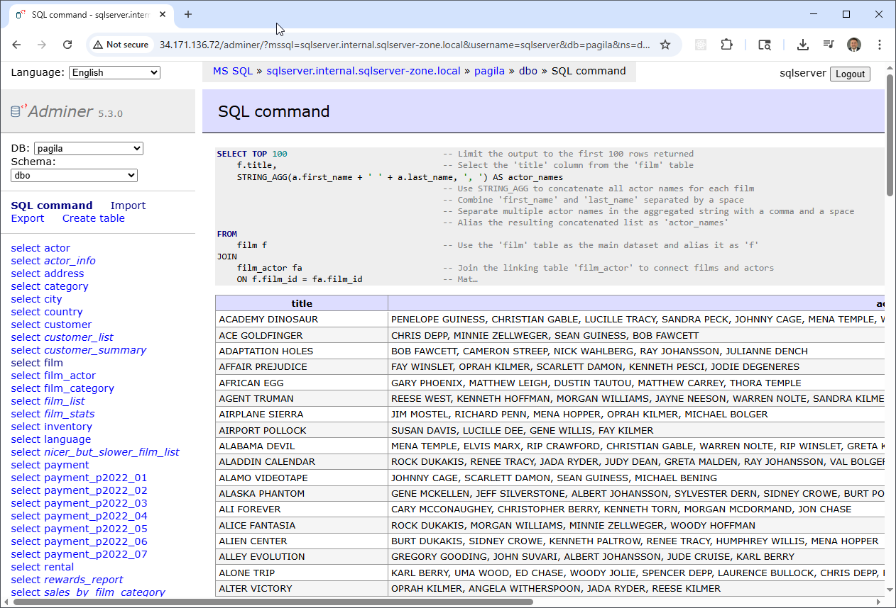
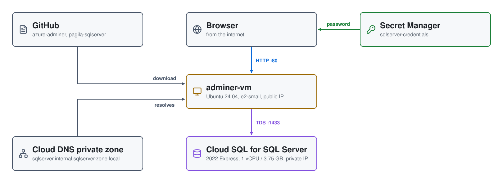

# SQL Server on GCP: Cloud SQL for SQL Server with Adminer

A private **Cloud SQL for SQL Server** instance (SQL Server 2022 Express),
built with Terraform and loaded with a SQL Server port of
[Pagila](https://github.com/mamonaco1973/pagila-sqlserver). The instance has
no public IP; an **Adminer** VM with a public IP gives you a browser client
for it.



| Piece | Where | Role |
|---|---|---|
| **Cloud SQL for SQL Server** | private IP, peered to `sqlserver-vpc` | `sqlserver-instance`, `SQLSERVER_2022_EXPRESS`, `db-custom-1-3840` (1 vCPU, 3.75 GB), zonal, automated backups, Sunday 03:00 maintenance window; no public IP |
| **Private service access** | `sqlserver-vpc` | a reserved /16 range peered to Google's service network, which is where the instance's private IP comes from |
| **Cloud DNS private zone** | visible to `sqlserver-vpc` | `internal.sqlserver-zone.local`, with `sqlserver.internal.sqlserver-zone.local` pointing at the instance |
| **adminer-vm** | `sqlserver-subnet`, public IP | Ubuntu 24.04, `e2-small`, `us-central1-a`; loads Pagila with `sqlcmd`, then serves Adminer with the PHP SQL Server drivers |
| **Secret Manager** | global | `sqlserver-credentials`: the `sqlserver` user and password |

## Architecture

<picture>
  <source media="(prefers-color-scheme: dark)" srcset="architecture-dark.svg">
  
</picture>

Regenerate with `python3 make_diagram.py`.

- **`01-sqlserver/`** is the whole stack: the VPC (`sqlserver-vpc`) with
  `sqlserver-subnet` (10.0.0.0/24), the firewall rules, the private service
  access range and peering, the Cloud SQL instance, the private DNS zone, the
  secret, and the Adminer VM.

## How it boots

1. Terraform builds the VPC and the private service access peering, then
   waits 5 minutes for the peering to propagate before creating the Cloud SQL
   instance. It generates a 24-character password and sets it on the
   instance's built-in `sqlserver` user.
2. The VM's startup script installs Microsoft's `mssql-tools`, clones
   [`pagila-sqlserver`](https://github.com/mamonaco1973/pagila-sqlserver),
   and runs its four scripts with `sqlcmd` against
   `sqlserver.internal.sqlserver-zone.local`: create the `pagila` database,
   then the tables, the data, and the views, functions and indexes. Each step
   logs to `/tmp/<script>.log` and `/tmp/<script>.error`.
3. It installs Apache, PHP and the `sqlsrv` / `pdo_sqlsrv` drivers, clones
   the [`azure-adminer`](https://github.com/mamonaco1973/azure-adminer) fork
   of Adminer into `/var/www/html`, and redirects `/` to `/adminer`.

## Firewall rules

```
internet ─80, 22─▶ adminer-vm ─1433─▶ Cloud SQL (peered private IP)
```

| Rule | Port | Applies to |
|---|---|---|
| `sqlserver-allow-http` | tcp 80 | adminer-vm |
| `sqlserver-allow-ssh` | tcp 22 | adminer-vm |

Both allow `0.0.0.0/0`. The Cloud SQL instance has no public IP, so it can
only be reached from inside the VPC.

## Prerequisites

* [A Google Cloud Account](https://console.cloud.google.com/)
* [Install gcloud CLI](https://cloud.google.com/sdk/docs/install)
* [Install Terraform](https://developer.hashicorp.com/terraform/install)
* [Install jq](https://jqlang.github.io/jq/download/)

Put a service account key in the repository root as `credentials.json`.
Terraform uses it, and `check_env.sh` activates it and runs `api_setup.sh`,
which enables the Cloud SQL Admin, Service Networking, Compute and other APIs
the build needs. If this is your first time watching our content, we
recommend starting with this video:
[GCP + Terraform: Easy Setup](https://youtu.be/3spJpYX4f7I).

## Deploy

```bash
git clone https://github.com/mamonaco1973/gcp-sqlserver.git
cd gcp-sqlserver
./apply.sh       # one phase: VPC, peering, Cloud SQL, DNS, secret, Adminer VM
```

Everything deploys to `us-central1`. `apply.sh` ends by running
`validate.sh`, which waits for Adminer to answer (up to 15 minutes) and
prints:

```
================================================================================
BUILD OUTPUTS
================================================================================
Adminer URL:           http://203.0.113.10/adminer
SQL Server hostname:   sqlserver.internal.sqlserver-zone.local
================================================================================
```

## Try it

1. Get the password from Secret Manager:

   ```bash
   gcloud secrets versions access latest --secret=sqlserver-credentials \
     | jq -r .password
   ```

2. Open the Adminer URL and sign in with System **MS SQL**, Server
   `sqlserver.internal.sqlserver-zone.local`, user `sqlserver`, that password,
   and database `pagila`.
3. Run the sample queries from **SQL command**:

   ```sql
   SELECT TOP 100
       f.title AS film_title,
       a.first_name + ' ' + a.last_name AS actor_name
   FROM film f
   JOIN film_actor fa ON f.film_id = fa.film_id
   JOIN actor a ON fa.actor_id = a.actor_id
   ORDER BY f.title, actor_name;
   ```

   ```sql
   SELECT TOP 100
       f.title,
       STRING_AGG(a.first_name + ' ' + a.last_name, ', ') AS actor_names
   FROM film f
   JOIN film_actor fa ON f.film_id = fa.film_id
   JOIN actor a ON fa.actor_id = a.actor_id
   GROUP BY f.title
   ORDER BY f.title;
   ```

## Troubleshooting

| Symptom | Fix |
|---|---|
| `validate.sh` keeps retrying | The VM is still installing; the PHP drivers build from source with `pecl`. `gcloud compute ssh adminer-vm --zone us-central1-a`, then `sudo journalctl -u google-startup-scripts`. |
| `pagila` is missing or empty | Read `/tmp/*.error` on the VM; each `sqlcmd` step writes its errors there. |
| Adminer can't reach the server | `nslookup sqlserver.internal.sqlserver-zone.local` on the VM should return the instance's private IP. |
| Sign-in fails | The user is `sqlserver`, Cloud SQL's built-in admin, not `sqladmin`. |

## Teardown

```bash
./destroy.sh     # deletes the Cloud SQL instance with gcloud first, then destroys the stack
```

The instance is deleted first so that Terraform can then remove the private
service access peering.

## Notes

- **Lab only.** Adminer is open to the internet over plain HTTP, SSH is open
  from anywhere, the database password is in the VM's startup script
  metadata, and the VM runs as the same service account as Terraform with
  the `cloud-platform` scope. Restrict the firewall rules and use a narrower
  VM service account for anything more.
